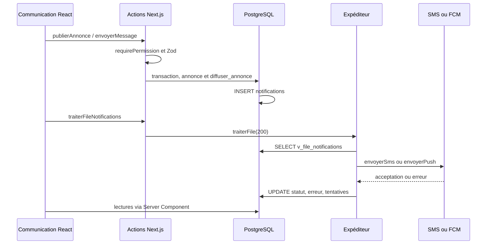
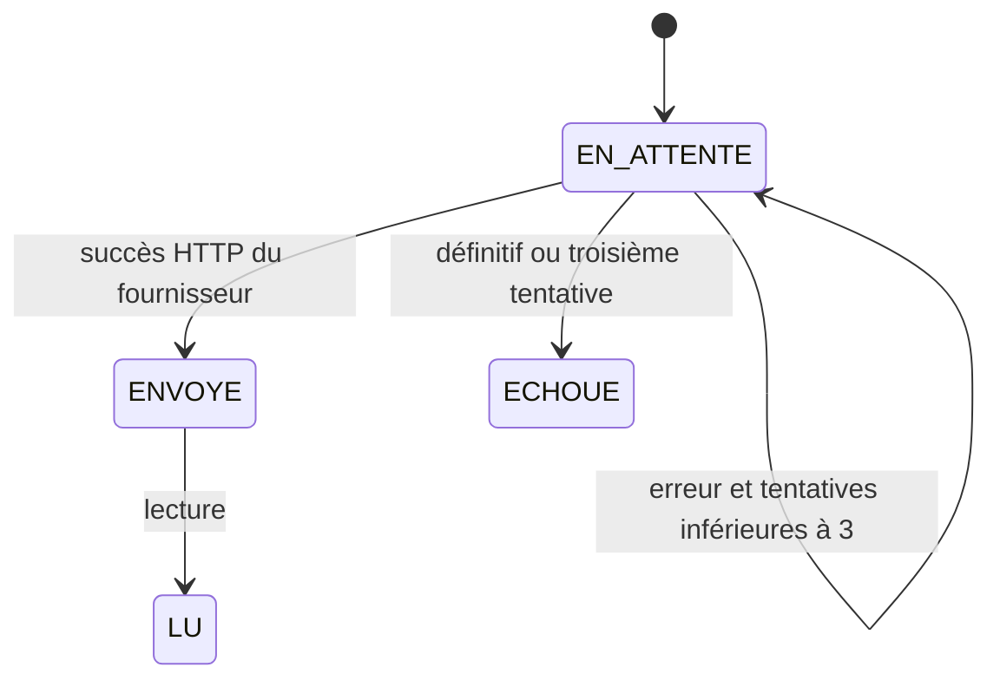
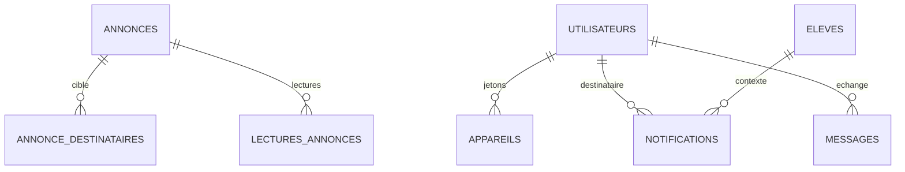

# Audit statique — base 4516039, 26 octobre 2026
Les références ci-dessous désignent la base de départ, avant reformatage. Les chiffres de capture ne sont pas des résultats de requêtes exécutées. Aucun accès à la base réelle ni export des 922 lignes dans cette session.

## Chaîne reconstituée

Aucun webhook de livraison n'a été retrouvé. Le retour HTTP du fournisseur était traité comme un envoi, sans preuve de réception sur le téléphone.

La vue limite à `tentatives < 3`, l'expéditeur ignore IN_APP, et aucun verrou ne réserve la ligne. `db/migrations/0020_communication.sql:331` (voir recherche exacte dans le fichier) et `web/src/server/notifications/expediteur.ts:100`.

Modèle : `db/migrations/0007_communication.sql:1`, extensions `0020`, fonctions remplacées par `0024`, `0027`, `0029`. `diffuser_annonce` reste la version 0020 et n'utilise PAS `fn_notifier_tuteurs` corrigée ensuite.

## O1 à O17
| Observation | Verdict | Preuve sur la base de départ |
|---|---|---|
| O1 Gentelella absent de Communication | Confirmé pour cette page | `web/AGENTS.md:5` décrit shadcn ; `communication/_components/communication.tsx:1` importe Card/Dialog/Table ; sources officielles présentes dans `src/vendor/gentelella-v4/README.md:1` mais non importées par Communication |
| O2 Search, ⌘J, conflit Windows | Confirmé | `dashboard/_components/header/search-dialog.tsx:136`, `:193`, `:195` |
| O3 année en dur | Infirmé pour Communication | `communication/page.tsx:29` appelle chargerAnneeCourante, puis utilise annee.libelle. Une année ancienne en base ne prouve pas un texte en dur |
| O4 47=35+0+12 ; 922 échecs | Partiel | `server/domain/communication.ts:174` ne répartit que PUSH/SMS. IN_APP et EMAIL ne sont pas détaillés. Les valeurs exactes restent non vérifiées |
| O5 traitement et IN_APP bloqué | Confirmé dans le code, incident particulier non vérifié | `expediteur.ts:185` ignore IN_APP ; `web/vercel.json:12` contient un cron quotidien. `reveil.ts:66` existe pour certains événements : worker totalement absent est donc infirmé |
| O6 coût simplifié | Confirmé, incohérence plus forte | `domain/communication.ts:204` multiplie par 25 ; `lib/tarifs.ts:26` définit déjà 50 FCFA/segment ; `notifications/sms.ts` ajoute une signature |
| O7 promesse absolue | Confirmé | `communication/page.tsx:69` ; absence de vérification de couverture réelle |
| O8 journal insuffisant | Confirmé | `communication/_components/communication.tsx:367` ; erreur en DTO mais pas rendue ; 50 dernières lignes dans page.tsx, aucune pagination |
| O9 données de test en production | Hypothèse | scripts de peuplement et migration 0021 existent ; cela ne prouve ni la présence actuelle ni une facturation. Aucun numéro réel n'a été extrait |
| O10 texte de réunion / encodage | Hypothèse pour le texte ; mécanisme confirmé | `lib/segments-sms.ts:81` traite GSM-7/UTF-16, mais l'estimation de file l'ignore. Aucun contenu réel de l'annonce lu |
| O11 11 annonces, 549 et lectures | Partiel | `domain/communication.ts:61` compte les notifications par donnees.annonce_id, sans filtrer statut ni canal ni destinataire unique ; 549 pourrait être des lignes de canaux ou plusieurs enfants. Aucun taux ni dénominateur. Valeurs non vérifiées |
| O12 expiration/actions | Confirmé partiellement | formulaire expireLe facultatif, pas de modification/programmation/duplication ; `:313` appelle basculerAnnonce directement, sans confirmation |
| O13 défaut et audience | Confirmé | `:575` defaultChecked ; `actions.ts:55` default(true). `diffuser_annonce` cible principal seulement pour TOUS et choisit PUSH sur présence de compte, pas appareil actif |
| O14 ciblage limité et téléphone clair | Confirmé | `:626` sérialise téléphone dans option, liste limitée à 500 dans domain/communication.ts ; compte actif obligatoire dans la lecture mais destinataire non revérifié à l'envoi |
| O15 messagerie bidirectionnelle | Partiel | table messages avec message_parent_id dans 0007 ; aucune route mobile messages trouvée, aucun écran mobile de messagerie dans la recherche. Le zéro observé ne prouve pas absence d'historique |
| O16 accents/date | Hypothèse pour captures | les chaînes exactes ne sont pas établies dans ce code. Ne pas corriger des données ni inventer une date |
| O17 contraste | À mesurer | tokens Gentelella text-muted #7e8896 sur blanc ; nouveaux styles doivent passer un contrôle automatique et ne pas hériter aveuglément de ce gris |

## Échecs et statistiques
Trois tentatives : `tentatives >= 3` dans expediteur.ts, pas une règle fournisseur. Les erreurs non définitives reviennent après 1 puis 5 minutes ; après la troisième, ECHOUE. La date calculée de 25 minutes ne sera pas utilisée pour ces lignes, puisqu'elles sont abandonnées. Config absente : file laissée en attente, sans consommation de tentative.

Les 12 peuvent relever de IN_APP ou EMAIL : impossible de trancher sans GROUP BY canal,statut. Les 549 sont un nombre de lignes, pas un nombre de familles délivrées. Zéro peut signifier absence de notifications (envoyer_push=false), audience vide, ou données.annonce_id absent. Les lectures n'ont pas la même unité que les lignes de notification. Les 922 ne peuvent être répartis, ni leur coût reconstitué sans export et rapprochement fournisseur. Aucun de ces chiffres n'est certifié ici.

## Intégration des modules
| Module | Données / point d'intégration existant | Événement / restriction |
|---|---|---|
| Élèves | eleve_tuteur, tuteurs, inscriptions ; utilisateurs/appareils | changement de statut, fn_notifier_tuteurs ; limiter les détails sensibles |
| Classes | inscriptions actives, classes.niveau_id | audience par classe ; changement d'emploi du temps sans déclencheur de notification retrouvé |
| Comptes parents | compte actif, consentement SMS, téléphone, appareils.langue | invitations/relances ; préférence par type dans politiques_notification |
| Emploi du temps | affectations et créneaux | événement à ajouter après définition des remplacements ; éviter doublon sur chaque ligne |
| Notes | trg_notifier_notes_publiees (0024:192) | publication seulement, pas chaque saisie |
| Bulletins | trg_notifier_bulletin (0024:352) | publication ; message ne doit pas diffuser la note dans le push |
| Assiduité | trg_notifier_absence et trg_notifier_retard | événement transactionnel ; dédoublonner l'événement métier |
| Discipline | trg_notifier_incident et trg_notifier_sanction | restreindre personnel et famille concernée ; pas de détail sensible en SMS |
| Tableau de bord | indicateurs existants et v_couverture_notifications | santé, retard, coût et couverture ; pas un autre producteur d'envoi |

Le choix de canal tient compte d'appareils actifs dans `fn_canal_joignable` (0024:49) mais pas dans `diffuser_annonce`. Pas de champ unique de langue préférée du tuteur établi : appareils.langue n'est pas un substitut fiable. Les responsabilités secondaires sont dans eleve_tuteur ; ne pas les contacter automatiquement sans règle explicite.

## Sécurité et correctifs prioritaires
| Problème | Impact | Effort | Correctif |
|---|---|---|---|
| Simulation confondue avec succès | fausse preuve d'envoi | faible | séparation et garde avant tout réseau |
| File non réservée | doublon et dépense | moyen | outbox avec SKIP LOCKED et bail |
| marquerMessageLu sans destinataire | IDOR, faux accusés | faible | filtrer par acteur en base |
| destinataire non revérifié | mauvais parent/élève | faible | compte actif et lien élève-tuteur côté serveur |
| numéro et erreurs brutes client | exposition données familles | faible | masquage avant sérialisation, catégorie d'erreur |
| facture = nombre de lignes ×25 | dépense sous-estimée | faible | calcul segments avec signature et tarif partagé |
| cron quotidien | SLA 15 min impossible seul | moyen | worker externe dédié sur environnement de recette, puis décision fournisseur |
| journaux et actions sans périmètre fin | consultation excessive | moyen | permission publication pour espace V2 et tests adversariaux |
| campagne sans estimation | dépense involontaire | moyen | aperçu recalculé en transaction + budget verrouillé |

Les Server Actions bénéficient du contrôle Origin/Host Next.js (documentation locale lue). Cela ne remplace ni validation Zod, ni permission, ni périmètre. Aucun `dangerouslySetInnerHTML` n'est nécessaire pour Gentelella V2.
